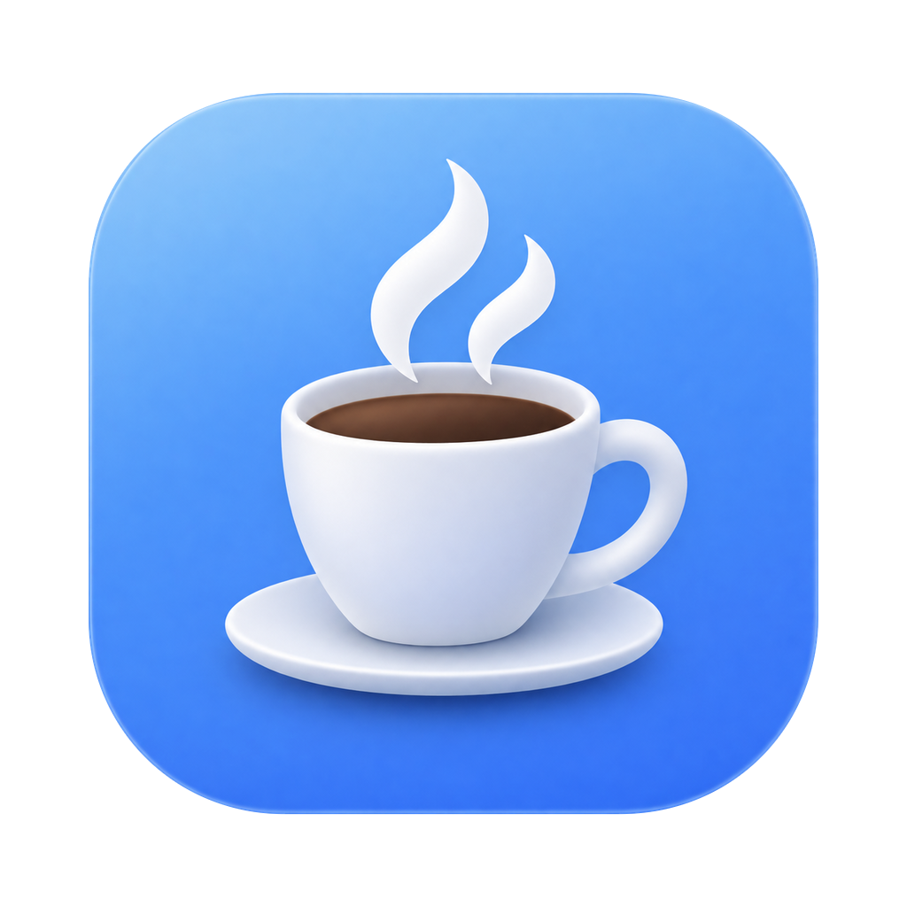
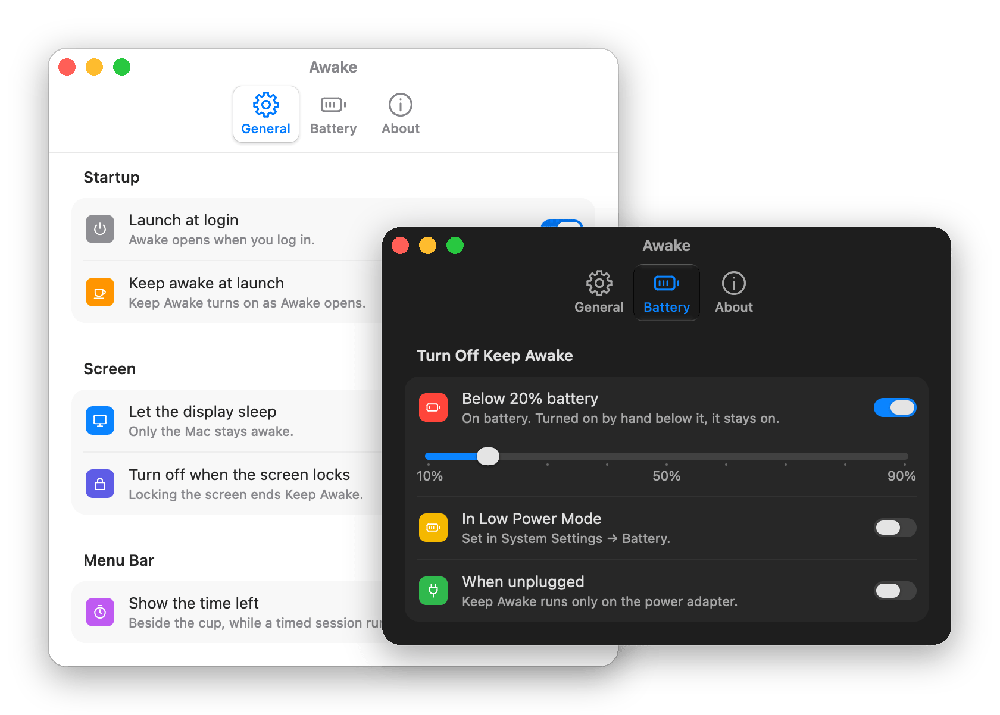

<div align="center">



# Awake

**Keeps your Mac awake from the menu bar**

[](#-install)
[](https://github.com/vladkens/awake/releases)
[](https://github.com/vladkens/awake/blob/main/LICENSE)
[](https://x.com/uid127)
[](https://buymeacoffee.com/vladkens)

</div>

**Click the cup, pick how long**, and your Mac stays awake through a build, a download or a long call. It turns off when the time is up or, if you choose, when the screen locks or the battery runs low. Scripts and agents keep the Mac awake too, from the command line.

<p align="center">
  
</p>

## 💡 Why

Awake does what [KeepingYouAwake](https://github.com/newmarcel/KeepingYouAwake) does, with what I missed in it:

- A click on KeepingYouAwake's icon toggles it, so a missed click turns it off. A click on Awake's cup only opens the menu.
- A command line with named holds: an agent keeps the Mac awake while it works and never ends what you turned on.
- It's in Rust, which I write every day, with no Swift or Xcode project. The UI is drawn by [nimbo](https://github.com/vladkens/nimbo), my small Rust UI toolkit, and Awake helps test it.

How it compares, measured on an M5 with macOS 27.2:

- Memory at idle, only the menu bar icon: Awake 13 MB, KeepingYouAwake 1.6.8 (Objective-C) 13 MB.
- Memory with the settings window open: Awake on nimbo 22 MB, the same app with an AppKit window 29 MB.
- App size: Awake.app 3.6 MB (0.8 MB of it the icon), KeepingYouAwake.app 7.6 MB.

## 🌟 Features

- ☕ **A click never toggles**: the cup opens the menu, so a missed click turns nothing off
- ⏱️ **For a while or until off**: 15 min to 8 h, the time left in the menu and beside the cup
- 🖥️ **Lets the display sleep**: only the Mac stays awake (`caffeinate -i` instead of `-d`)
- 🔒 **Turns off when the screen locks**
- 🔋 **Battery rules**: off below a level (10–90 %), in Low Power Mode or when unplugged
- 🚀 **Starts with the Mac**: launch at login, and keep awake at launch
- 🤖 **A command line for scripts and agents**: `awake on 1h`, `awake -- make release`, named holds
- 🔄 **Updates itself** from the releases here, checked once a day
- 🌍 **13 languages**: the Mac's, or the one set for Awake in System Settings
- 🪶 **Idle at 0 % CPU**: nothing polls, macOS tells Awake what changed

## 📥 Install

macOS 13 or later, Apple silicon or Intel. With Homebrew, which also links the command line as `awake`:

```sh
brew install --cask vladkens/tap/awake
```

Or download the DMG from the [latest release](https://github.com/vladkens/awake/releases/latest): open it and drag Awake into Applications. It is signed and notarized by Apple, and updates itself from there.

## 🚀 Usage

Click the cup in the menu bar and pick Keep Awake Indefinitely, or a length under Keep Awake For; Turn Off in the same place ends it. Settings… in the menu, or opening the app again, shows the settings window.

A rule that turns Keep Awake off, such as a low battery, doesn't stop you: turned on by hand while it applies, Keep Awake stays on until its cause clears.

### Command line

The app's binary takes commands and passes them to the running Awake, opening it first when needed. The Homebrew cask links it as `awake`; otherwise run `/Applications/Awake.app/Contents/MacOS/awake`.

```sh
awake on 1h               # keep awake for an hour: 90 (minutes), 45m, 2h, 1h30m; no length: until off
awake off                 # turn off, holds too
awake status              # what keeps the Mac awake
awake -- make release     # keep awake while the command runs, exit with its status
awake hold build --for 2h # a named hold: until `awake release build`, or for the length
awake release build
```

Holds keep the Mac awake beside the menu's session, so a script or an agent never turns off what you turned on. The menu lists them, and Turn Off ends them too. The battery rules apply to them; locking the screen doesn't end them. A command's hold ends with it, even when it's killed.

<details>
<summary>Keep the Mac awake while Claude Code works</summary>

Hooks in `~/.claude/settings.json` keep the Mac awake while Claude Code works, an hour at most if a turn never ends. Each session holds by its own name, so one that ends leaves the others' holds. They need `jq`, part of macOS since 15 (`brew install jq` before it):

```json
{
  "hooks": {
    "UserPromptSubmit": [{ "hooks": [{ "type": "command", "command": "awake hold claude-$(jq -r '.session_id[:8]') --for 1h" }] }],
    "Stop": [{ "hooks": [{ "type": "command", "command": "awake release claude-$(jq -r '.session_id[:8]')" }] }]
  }
}
```

</details>

<details>
<summary>Build from source</summary>

With a recent stable Rust and [shipo](https://github.com/vladkens/shipo):

```sh
git clone https://github.com/vladkens/awake && cd awake
make run   # builds and starts Awake Dev
```

Awake Dev has its own id and settings, so it runs beside an installed Awake. `pmset -g assertions` shows which of the two holds the Mac.

</details>

## 🤝 Contributing

Pull requests are welcome, including ones made with agents: point yours at [agents.md](agents.md).

## 📝 License

Distributed under the [MIT License](LICENSE).
